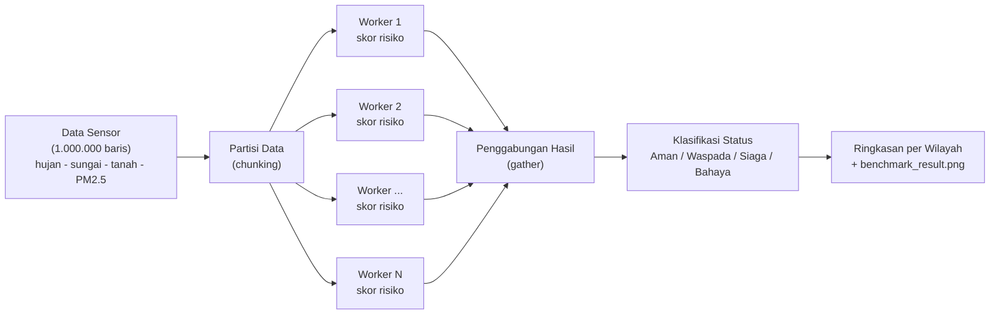

# Simulasi Komputasi Paralel untuk Prediksi Indeks Bahaya Banjir dan Polusi Udara (PM2.5) Lokal Berbasis Multi-Sensor


Proyek tugas kuliah **High Performance Computing (HPC)** yang mendemonstrasikan perbedaan **pemrosesan serial** dan **pemrosesan paralel** (`multiprocessing.Pool`) pada kasus prediksi risiko banjir dan polusi udara dari jutaan data sensor. Proyek ini terinspirasi materi kuliah praktisi *"Bridging Global Infrastructure to Address Local Challenge with HPC"*.

> **Catatan:** seluruh data sensor dan model risiko pada repositori ini bersifat **sintetis dan disederhanakan** untuk tujuan pembelajaran. Hasilnya **bukan** prediksi resmi dan tidak boleh dipakai sebagai dasar keputusan kebencanaan nyata.

---

## Daftar Isi

1. [Latar Belakang Studi Kasus](#latar-belakang-studi-kasus)
2. [Arsitektur Workflow](#arsitektur-workflow)
3. [Struktur Repositori](#struktur-repositori)
4. [Cara Menjalankan Kode](#cara-menjalankan-kode)
5. [Penjelasan `job_submission.sh`](#penjelasan-job_submissionsh)
6. [Membaca Hasil Benchmark](#membaca-hasil-benchmark)
7. [Kesimpulan](#kesimpulan)

---

## Latar Belakang Studi Kasus

Infrastruktur HPC global (supercomputer, cluster nasional, dan jaringan riset) umumnya dikembangkan untuk simulasi berskala besar seperti prakiraan cuaca, pemodelan iklim, dan analisis data sains. Namun, inti dari materi *Bridging Global Infrastructure to Address Local Challenge* adalah bahwa **kemampuan komputasi tersebut dapat dimanfaatkan untuk menjawab masalah lokal**: banjir, kualitas udara, efisiensi energi, hingga perencanaan kota.

Banyak wilayah di Indonesia, termasuk kota-kota pesisir dan daerah aliran sungai di Sumatera, menghadapi dua ancaman yang sering terjadi bersamaan:

- **Banjir** akibat curah hujan tinggi, kenaikan muka air sungai, dan tanah yang sudah jenuh.
- **Polusi udara (PM2.5)** akibat kendaraan, pembakaran, dan kondisi cuaca.

Kedua ancaman ini dipantau oleh banyak sensor sekaligus (*multi-sensor*): penakar hujan, sensor tinggi muka air, sensor kelembaban tanah, dan sensor partikel udara. Jika setiap sensor mengirim pembacaan berkala, volume data bertambah sangat cepat. Menghitung skor risiko untuk jutaan pembacaan secara **serial** (satu per satu pada satu core) berpotensi terlalu lambat untuk kebutuhan peringatan dini.

Pendekatan **HPC** menyelesaikan masalah ini dengan memecah pekerjaan menjadi bagian-bagian independen yang dihitung **bersamaan** oleh banyak core. Repositori ini menunjukkan konsep tersebut dalam skala kecil di satu mesin dengan modul `multiprocessing` Python, dan menyediakan skrip `SLURM` untuk menunjukkan bagaimana pekerjaan yang sama diajukan ke cluster sungguhan.

### Model skor risiko (disederhanakan)

Untuk setiap titik sensor, program menghitung **Skor Risiko Bencana & Polusi (0-100)**:

| Komponen | Masukan | Proses |
|---|---|---|
| Indeks banjir (bobot 60%) | curah hujan, tinggi air sungai, kelembaban tanah | simulasi akumulasi limpasan air selama sejumlah langkah waktu, lalu normalisasi sigmoid |
| Indeks PM2.5 (bobot 40%) | kadar PM2.5 | simulasi fluktuasi/dispersi partikel selama sejumlah langkah waktu, lalu normalisasi |

Skor kemudian diklasifikasikan menjadi status:

| Skor | Status |
|---|---|
| < 45 | Aman |
| 45 - < 60 | Waspada |
| 60 - < 75 | **Siaga** |
| >= 75 | **Bahaya** |

Fungsi perhitungan sengaja dibuat padat operasi *floating-point* (`exp`, `tanh`, `sqrt`, `log1p`, `sin`, `cos`) agar beban CPU nyata dan perbedaan waktu serial vs paralel dapat diamati.

---

## Arsitektur Workflow



Alur kerja pada kode:

1. **Data Sensor**: `buat_data_sensor()` membangkitkan data sintetis untuk 9 wilayah.
2. **Parallel Processing**: `jalankan_paralel()` memecah data menjadi beberapa chunk (jumlah worker x 4) dan membagikannya ke `multiprocessing.Pool` (pola *data parallelism*: kode yang sama, data berbeda).
3. **Hasil Prediksi**: skor tiap chunk digabung kembali sesuai urutan asli, diklasifikasikan, diringkas per wilayah, lalu divisualisasikan.

Metode serial memakai fungsi hitung yang **identik** (`proses_chunk`) pada seluruh data di satu proses, sehingga perbandingan waktu adil. Program juga memverifikasi bahwa hasil paralel sama dengan hasil serial (`np.allclose`).

---

## Struktur Repositori

```
.
├── simulasi_hpc_banjir.py   # program utama: generator data, serial, paralel, benchmark
├── job_submission.sh        # contoh batch script SLURM
├── README.md                # dokumentasi ini
└── benchmark_result.png     # (dihasilkan otomatis setelah program dijalankan)
```

---

## Cara Menjalankan Kode

### Prasyarat

- Python 3.9 atau lebih baru
- Pustaka `numpy` dan `matplotlib`

```bash
pip install numpy matplotlib
```

### Menjalankan di komputer lokal

```bash
python3 simulasi_hpc_banjir.py
```

Di Windows gunakan `python simulasi_hpc_banjir.py`.

Opsi tambahan:

| Opsi | Fungsi | Contoh |
|---|---|---|
| `--rows N` | jumlah baris data (default 1.000.000) | `--rows 200000` |
| `--iterations N` | kedalaman simulasi per titik (default 25) | `--iterations 40` |
| `--workers N` | jumlah proses paralel (default: semua core) | `--workers 4` |
| `--scaling` | uji tambahan speedup untuk 1, 2, 4, ... worker | `--scaling` |
| `--output FILE` | nama file grafik | `--output hasil.png` |

Contoh uji cepat (beberapa detik):

```bash
python3 simulasi_hpc_banjir.py --rows 100000
```

### Menjalankan di cluster SLURM

```bash
sbatch job_submission.sh
squeue -u $USER
```

### Keluaran program

- Waktu eksekusi serial dan paralel (detik), **speedup**, dan **efisiensi**
- Tabel ringkasan wilayah dengan titik berstatus **Siaga/Bahaya**
- Berkas grafik `benchmark_result.png`

---

## Penjelasan `job_submission.sh`

Pada supercomputer atau cluster, pengguna **tidak** menjalankan program langsung di *login node*. Pekerjaan diajukan sebagai *job* ke penjadwal (*scheduler*) seperti **SLURM**, yang mengalokasikan sumber daya dan menjalankannya saat tersedia. Berkas `job_submission.sh` adalah contoh *batch script* untuk alur kerja tersebut.

| Direktif | Arti |
|---|---|
| `#SBATCH --job-name=hpc_banjir_pm25` | nama job pada antrean |
| `#SBATCH --output=logs/banjir_%j.out` | berkas keluaran standar (`%j` = Job ID) |
| `#SBATCH --error=logs/banjir_%j.err` | berkas pesan galat |
| `#SBATCH --partition=compute` | antrean/partisi yang dipakai (sesuaikan dengan cluster) |
| `#SBATCH --nodes=1` | jumlah node; `multiprocessing` hanya berjalan dalam **satu** node |
| `#SBATCH --ntasks=1` | satu proses utama Python |
| `#SBATCH --cpus-per-task=16` | jumlah core untuk `multiprocessing.Pool` |
| `#SBATCH --mem=16G` | memori RAM yang diminta |
| `#SBATCH --time=00:30:00` | batas waktu; job dihentikan jika melewatinya |

Bagian penting lain pada skrip:

- `SLURM_CPUS_PER_TASK`: `simulasi_hpc_banjir.py` membaca variabel ini secara otomatis sehingga jumlah worker selalu sesuai alokasi core, bukan seluruh core di node.
- `OMP_NUM_THREADS=1` dan variabel sejenis: mencegah pustaka numerik membuat thread tambahan di tiap proses (agar tidak terjadi *oversubscription*).
- Bagian `module load` dan `venv` diberi komentar sebagai contoh penyiapan lingkungan.

> `multiprocessing` hanya memanfaatkan core pada **satu node**. Untuk memakai banyak node sekaligus diperlukan pustaka seperti **MPI** (`mpi4py`), yang berada di luar cakupan proyek ini.

---

## Membaca Hasil Benchmark

Setelah program selesai, `benchmark_result.png` memuat:

1. Perbandingan waktu eksekusi serial vs paralel beserta speedup.
2. Jumlah titik Siaga/Bahaya per wilayah.
3. (Dengan `--scaling`) kurva speedup terhadap jumlah core dibandingkan speedup ideal.

Beberapa hal yang perlu dipahami saat menganalisis hasil:

- **Speedup** = waktu serial / waktu paralel. **Efisiensi** = speedup / jumlah core.
- Speedup umumnya **tidak linear**. Penyebabnya antara lain biaya pembuatan proses, pengiriman data antarproses (*serialization*/pickling), bagian program yang tetap serial (hukum Amdahl), dan jumlah *physical core* yang lebih sedikit daripada *logical core* (hyper-threading).
- Pada data yang sangat kecil atau mesin dengan 1 core, versi paralel bisa **lebih lambat** daripada serial karena overhead tersebut. Keuntungan paralel baru terlihat pada beban komputasi yang cukup besar.
- Hasil waktu bergantung pada spesifikasi mesin Anda. Tambahkan hasil eksperimen Anda sendiri pada tabel berikut:

| Mesin / Core | Waktu Serial (s) | Waktu Paralel (s) | Speedup | Efisiensi |
|---|---|---|---|---|
| *(isi dari hasil percobaan Anda)* | | | | |

---

## Kesimpulan

1. **Beban komputasi risiko bersifat *embarrassingly parallel*.** Skor tiap titik sensor dihitung independen sehingga mudah dibagi ke banyak core tanpa komunikasi antarproses selama perhitungan, dan hasilnya terbukti identik dengan versi serial.
2. **Waktu adalah faktor kritis dalam mitigasi bencana.** Peringatan dini baru berguna jika skor risiko selesai dihitung sebelum kondisi memburuk. Semakin besar volume data sensor dan semakin kompleks modelnya, semakin besar pula kebutuhan akan komputasi paralel untuk menjaga waktu pemrosesan tetap singkat.
3. **Skalabilitas dari laptop ke cluster.** Pola yang sama (membagi data, menghitung bersamaan, menggabungkan hasil) dapat dikembangkan dari satu mesin ke cluster SLURM berpuluh core, lalu ke banyak node dengan MPI. Inilah makna "menjembatani infrastruktur global untuk tantangan lokal": satu pola komputasi, banyak skala.
4. **Keterbatasan perlu diakui.** Model risiko di sini disederhanakan dan datanya sintetis. Dalam sistem peringatan dini nyata, model dikalibrasi dengan data pengukuran dan divalidasi oleh lembaga berwenang (misalnya BMKG), dan kinerja paralel perlu dianalisis dengan memperhatikan overhead, efisiensi, dan hukum Amdahl.

### Pengembangan lanjutan

- Memakai `mpi4py` untuk eksekusi multi-node pada cluster.
- Memakai data sensor nyata (misalnya data publik BMKG atau data stasiun pemantau kualitas udara).
- Memakai model hidrologi atau machine learning yang lebih realistis.
- Membandingkan dengan akselerasi GPU (CuPy/Numba) atau vektorisasi NumPy penuh.

---

## Lisensi

Dibuat untuk keperluan akademik (tugas kuliah). Silakan digunakan dan dimodifikasi untuk pembelajaran.
